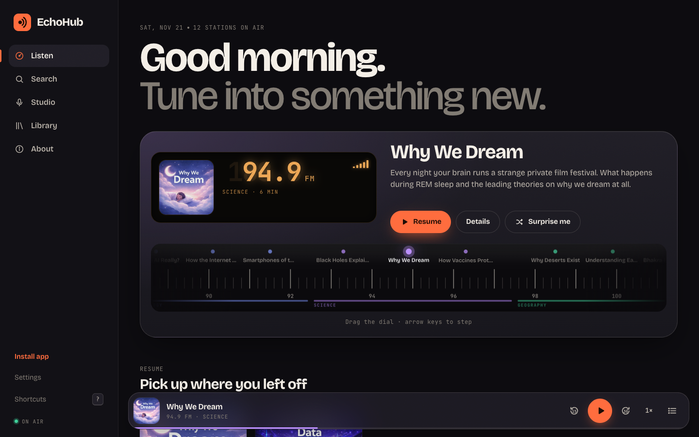
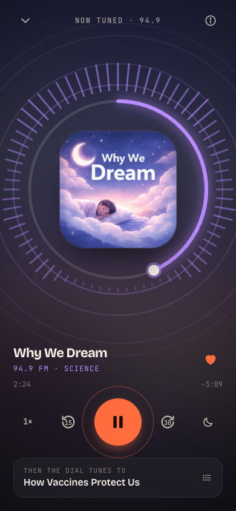
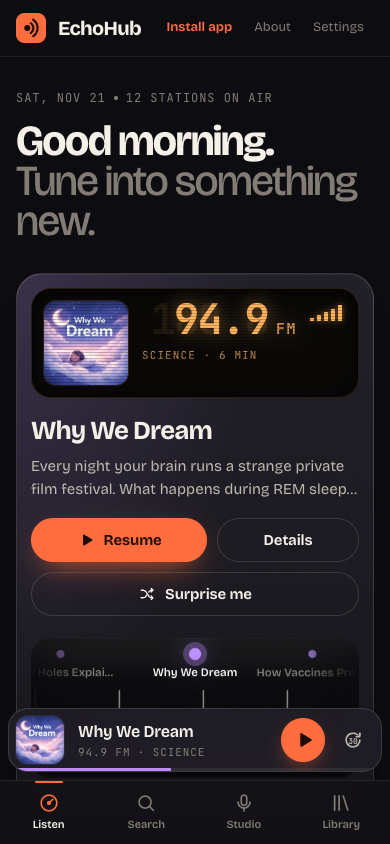
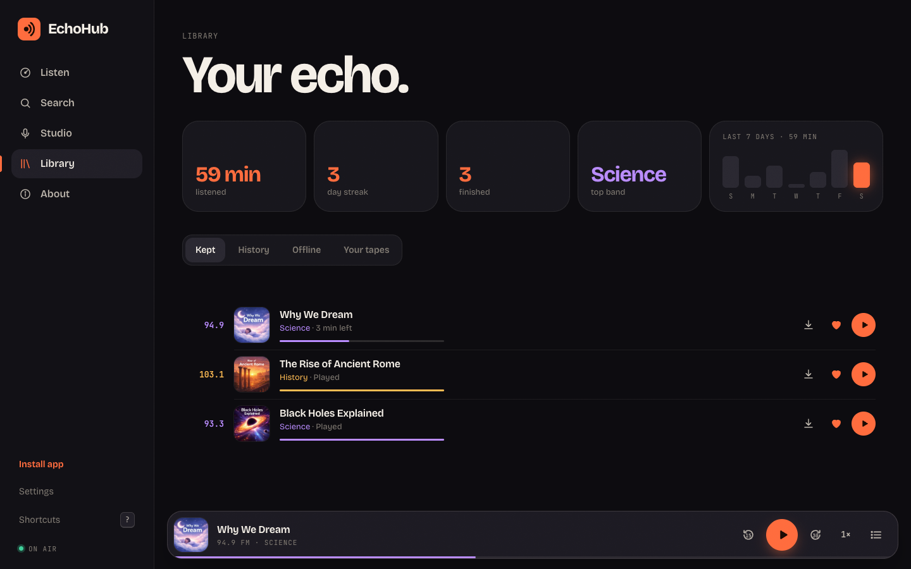
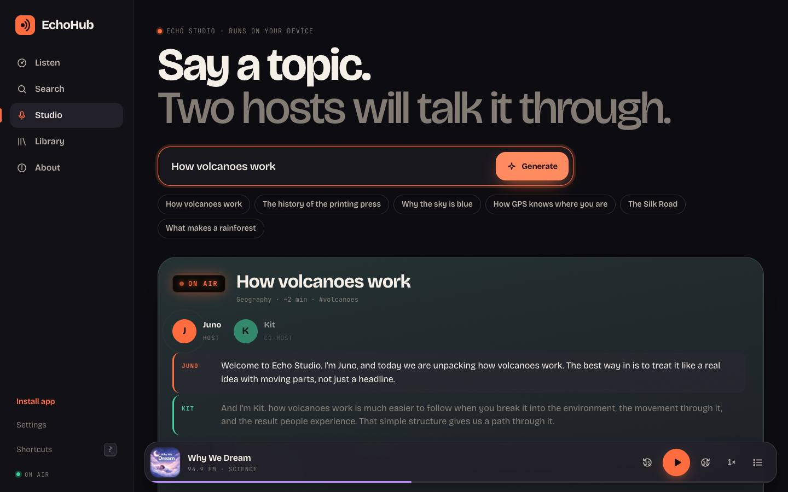
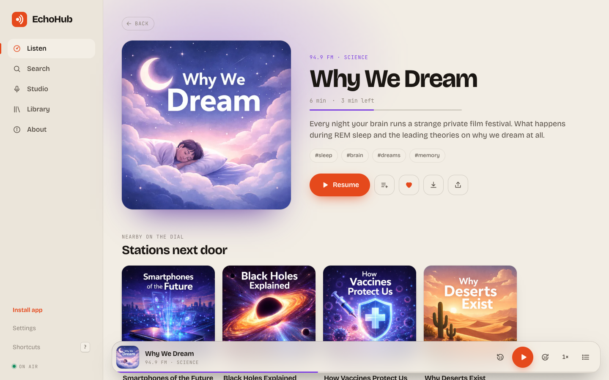

<div align="center">


# EchoHub

**A radio for curious minds.**
Drag the dial, land on a station, learn something in five minutes.

[**Open EchoHub →**](https://nikhildoesntcommit.github.io/EchoHub/)




</div>

---

> [!NOTE]
> **About this project.** The first version of EchoHub was built as a group submission for our school's **AINOVA** AI club by Nikhil, Bhumika, Maleeha, Ria and Jasmine, with the help of AI tools. That original podcast site has since been rebuilt into the standalone listening app in this repository. The first version is still available in the repository's commit history.

## Contents

- [What is EchoHub?](#what-is-echohub)
- [Features](#features)
- [The “Frequency” design language](#the-frequency-design-language)
- [On the dial](#on-the-dial)
- [Keyboard shortcuts](#keyboard-shortcuts)
- [Run it locally](#run-it-locally)
- [Deploy to GitHub Pages](#deploy-to-github-pages)
- [Project structure](#project-structure)
- [Adding a new episode](#adding-a-new-episode)
- [Privacy](#privacy)
- [Browser support](#browser-support)

## What is EchoHub?

EchoHub turns learning into **tuning**. Instead of an endless feed, you get an FM-style dial. Every episode is a station with its own frequency, grouped into four bands: **Technology**, **Science**, **Geography** and **History**. Drag the dial and you'll hear a little static between stations. Land on one, press play, and you'll have learned something new in two to six minutes.

It installs like a native app, keeps playing from your lock screen, saves episodes for offline listening, and keeps everything on your device. There's no account, no tracking and no ads.

## Features

| | |
|---|---|
| 📻 **The Tuner** | A draggable, momentum-scrolling FM dial with real station markers, band strips, an amber LCD readout and a signal-strength meter. Soft static plays between stations, and the dial snaps when you lock onto one. It also works with the keyboard and screen readers. |
| 💿 **Now Playing** | A circular **seek ring** around the cover (drag around it to scrub), plus an **echo-ring visualiser** driven by the actual audio, a sleep timer, playback speed, and swipe-down to dismiss. |
| 🔁 **Keep the dial playing** | When an episode ends, EchoHub tunes to the next station you haven't heard. You can also build your own **Up next** queue and reorder it. |
| 🎙️ **Echo Studio** | Type any topic and two hosts, *Juno* and *Kit*, talk it through. Scripts are generated on your device and read aloud by your browser's voices. A live teleprompter follows along. You can save, copy or download drafts. |
| 📚 **Library** | Kept stations, listening history, offline downloads and your own uploaded **tapes**, plus listening stats: total time, daily streak, finished episodes, top band and a 7-day chart. |
| 📼 **Your tapes** | Add your own audio (lectures, voice notes, recordings). It's stored privately in IndexedDB and never uploaded anywhere. |
| ✈️ **Offline & installable** | A service worker caches the app shell and artwork. Save any station for offline listening, and seeking still works with no connection. |
| 🔒 **Lock-screen controls** | Media Session integration gives you artwork, play/pause, skip and scrubbing from your OS media controls. |
| 🌗 **Night & Day themes** | Follows your system theme by default. Every screen is designed for both. |
| ♿ **Accessible** | Semantic landmarks, focus management, ARIA sliders for the tuner and seek ring, a skip link, full keyboard control and reduced-motion support. |

<table>
  <tr>
    <td width="33%"></td>
    <td width="33%"></td>
    <td width="33%"></td>
  </tr>
  <tr>
    <td align="center"><sub>Now Playing</sub></td>
    <td align="center"><sub>The Tuner on mobile</sub></td>
    <td align="center"><sub>Your echo (Library)</sub></td>
  </tr>
</table>



## The “Frequency” design language

EchoHub's look is built around one idea: **learning as radio**.

| Element | Treatment |
|---|---|
| **Palette** | Warm *night-studio* darks (`#0d0c10`) and a *daylight paper* light theme (`#f2ede4`), with a single **signal orange** (`#ff6b3d`) for anything you can play. |
| **Bands as colour** | Each band has its own frequency colour: Technology `#7d95ff`, Science `#b98bff`, Geography `#3fd19a`, History `#ffbb52`. It runs through station markers, cards, progress bars and the visualiser. |
| **LCD readouts** | Frequencies show in an amber phosphor display with unlit "188.8" ghost segments and scanlines, like a real tuner. |
| **Echo rings** | Concentric rings are the recurring motif. They pulse from play buttons, radiate from the Now Playing ring, and decorate band tiles. |
| **Type** | [Bricolage Grotesque](https://fonts.google.com/specimen/Bricolage+Grotesque) for display and UI, [JetBrains Mono](https://fonts.google.com/specimen/JetBrains+Mono) for frequencies, timestamps and labels. |
| **Texture** | A subtle film-grain overlay and soft inner shadows give surfaces a physical, hardware feel. |



## On the dial

| Freq (FM) | Station | Band | Length |
|---:|---|---|---:|
| 88.7 | What Is AI Really? | Technology | 6:09 |
| 90.1 | How the Internet Moves Data | Technology | 4:35 |
| 91.5 | Smartphones of the Future | Technology | 5:48 |
| 93.3 | Black Holes Explained | Science | 5:52 |
| 94.9 | Why We Dream | Science | 5:34 |
| 96.3 | How Vaccines Protect Us | Science | 4:39 |
| 98.5 | Why Deserts Exist | Geography | 5:18 |
| 99.9 | Understanding Earthquakes | Geography | 2:12 |
| 101.3 | Bhakra Nangal Dam | Geography | 2:57 |
| 103.1 | The Rise of Ancient Rome | History | 3:10 |
| 104.7 | Causes of World War I | History | 2:55 |
| 106.1 | Stories Behind the Taj Mahal | History | 2:17 |

## Keyboard shortcuts

| Key | Action |
|---|---|
| <kbd>Space</kbd> / <kbd>K</kbd> | Play / pause |
| <kbd>J</kbd> / <kbd>L</kbd> | Skip back / forward |
| <kbd>Shift</kbd>+<kbd>N</kbd> / <kbd>Shift</kbd>+<kbd>P</kbd> | Next / previous |
| <kbd>F</kbd> | Keep the current station |
| <kbd>S</kbd> | Cycle playback speed |
| <kbd>T</kbd> | Surprise me (spin the dial) |
| <kbd>M</kbd> | Open / close Now Playing |
| <kbd>/</kbd> | Search |
| <kbd>G</kbd> then <kbd>L</kbd> <kbd>S</kbd> <kbd>T</kbd> <kbd>B</kbd> | Go to Listen, Search, Studio or Library |
| <kbd>←</kbd> <kbd>→</kbd> | Step between stations (when the tuner is focused) |
| <kbd>?</kbd> | Show all shortcuts |

## Run it locally

EchoHub is plain HTML, CSS and JavaScript modules, so there's **no build step and nothing to install**. It does need to be served over HTTP (not opened as a `file://`), because ES modules and the service worker require it.

```bash
git clone https://github.com/nikhildoesntcommit/EchoHub.git
cd EchoHub
python3 -m http.server 8000
```

Then open <http://localhost:8000>.

> [!TIP]
> Python's built-in server doesn't support byte-range requests, so scrubbing in long episodes can be jumpy locally. Any range-capable server works better, for example `npx http-server -p 8000`. GitHub Pages supports ranges out of the box.

## Deploy to GitHub Pages

1. Push the repository to GitHub.
2. Go to **Settings → Pages**.
3. Under **Build and deployment**, choose **Deploy from a branch**, then select `main` and `/ (root)`.
4. Save. The site will be live at `https://<user>.github.io/<repo>/` within a minute or two.

Everything uses relative paths, so it works under any repository name. `404.html` sends deep links like `/EchoHub/ep/why-we-dream` to the matching in-app route, and `.nojekyll` makes Pages serve the files exactly as they are.

> [!IMPORTANT]
> When you change any file the app caches, bump `VERSION` in [`sw.js`](sw.js). Returning listeners will see a **"A new version of EchoHub is ready → Refresh"** prompt.

## Project structure

```text
EchoHub/
├── index.html              # App shell: rail, deck, Now Playing, sheets
├── 404.html                # GitHub Pages deep-link redirect
├── manifest.webmanifest    # PWA manifest (icons, shortcuts, screenshots)
├── sw.js                   # Service worker: offline shell + ranged audio cache
├── assets/
│   ├── css/app.css         # The "Frequency" design system
│   ├── js/
│   │   ├── main.js         # Boot, router, actions, keyboard, theme, install
│   │   ├── catalog.js      # Stations, bands and frequencies
│   │   ├── views.js        # Listen, Band, Episode, Search, Studio, Library, About
│   │   ├── components.js   # Cards, rows, covers, buttons
│   │   ├── tuner.js        # The FM dial + synthesised static
│   │   ├── player.js       # Audio engine, queue, Media Session, stats, sleep timer
│   │   ├── nowplaying.js   # Deck, seek ring, echo-ring visualiser
│   │   ├── studio.js       # On-device script engine + speech
│   │   ├── sheets.js       # Settings, queue, sleep, shortcuts, upload
│   │   ├── store.js        # Local, cross-tab-synced state
│   │   ├── offline.js      # Save-for-offline (Cache API)
│   │   ├── uploads.js      # Your tapes (IndexedDB)
│   │   └── ui.js           # Icons, formatting, toasts
│   ├── icons/              # App icons, favicon, maskable icon
│   └── img/                # Optimised covers (WebP), screenshots, social card
├── podcasts/               # Episode audio (MP3)
└── covers/                 # Original full-resolution cover artwork (source files)
```

## Adding a new episode

1. Drop the MP3 into `podcasts/`, for example `podcasts/how_volcanoes_work.mp3`.
2. Create a 640 px WebP cover in `assets/img/covers/` from your square artwork:

   ```bash
   sips -Z 640 covers/how_volcanoes_work.png --out /tmp/cover.png
   cwebp -q 78 /tmp/cover.png -o assets/img/covers/how_volcanoes_work.webp
   ```

3. Add an entry to `EPISODES` in [`assets/js/catalog.js`](assets/js/catalog.js), choosing an unused frequency inside its band's range:

   ```js
   ep({
     slug: 'how-volcanoes-work',
     file: 'how_volcanoes_work',
     title: 'How Volcanoes Work',
     band: 'geography',
     freq: 100.7,
     seconds: 245,
     tags: ['volcanoes', 'magma', 'earth', 'hazards'],
     description: 'What happens deep underground before an eruption.'
   }),
   ```

4. Add the cover to the `COVERS` list in [`sw.js`](sw.js) and bump `VERSION`.

## Privacy

EchoHub has no backend. Kept stations, history, progress, stats, drafts and settings live in `localStorage`. Your tapes live in IndexedDB, and offline downloads live in Cache Storage, all on your device. Nothing is collected, tracked or sent anywhere. The only third-party request is for the Google Fonts stylesheet. **Settings → Erase everything** wipes all of it.

## Browser support

EchoHub works in current versions of Chrome, Edge, Safari (macOS and iOS) and Firefox. Installation and lock-screen controls depend on the browser and platform. On iOS the visualiser uses a procedural animation, because routing audio through Web Audio would stop playback when the screen locks. Echo Studio's voices come from the operating system, so they sound different on each device.
